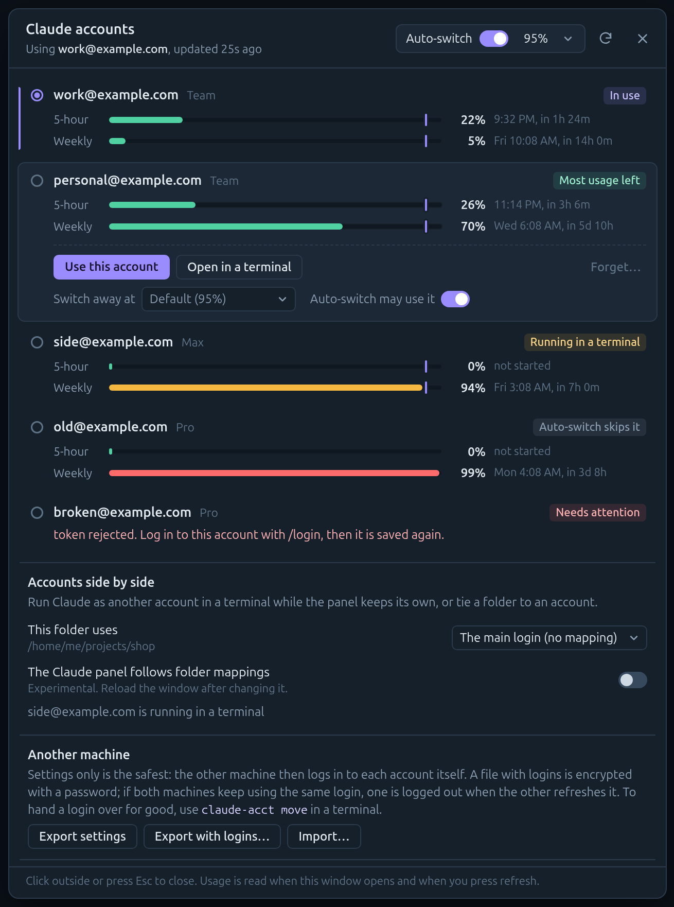

# Claude multi-account

Use several Claude (claude.ai) accounts on one machine without logging out, and always know
which one still has usage left.

- **Switch** accounts in a second; the chat you are in keeps going on the new account.
- **See usage** of every account: 5-hour and weekly %, reset times, in VS Code and the terminal.
- **Auto-switch** before a limit runs out (off until you turn it on).
- **Side by side**: a terminal or a folder on one account while everything else uses another.
- **Another machine**: carry settings over, or move logins, without breaking them.

It works with Claude Code in the terminal and in the VS Code extension, also over Remote-SSH.
Linux is the main platform; on macOS switching and usage work, parallel sessions do not. It
needs Python 3.8+ and nothing else (OpenSSL only for encrypted exports).

```
Claude accounts  (19 Nov 03:07 PM)
Auto-switch: ON at 95%  (claude-acct auto off)

  1. work@example.com [team]  <- active
       5h      4%  resets today 7:20 PM      week    2%  resets tomorrow 7:30 AM
  2. personal@example.com [pro]
       5h      0%  not started               week   99%  resets Mon 23 Nov 3:29 AM

Suggested: 1 (work@example.com)  (already active, no need to switch)
```

## Contents

- [Install](#install)
- [Everyday use](#everyday-use)
- [VS Code: status bar and accounts window](#vs-code-status-bar-and-accounts-window)
- [Auto-switch](#auto-switch)
- [Accounts side by side](#accounts-side-by-side)
- [Another machine: export, import, move](#another-machine-export-import-move)
- [How usage is read (and the rate limit)](#how-usage-is-read-and-the-rate-limit)
- [Safety](#safety)
- [All commands](#all-commands)
- [Files](#files)
- [Troubleshooting](#troubleshooting)
- [Development](#development)

## Install

1. Install Claude Code and log in to **one** account with `/login`.
2. Get this repo and run the installer:
   ```
   git clone <this repository's URL> claude-multi-account
   cd claude-multi-account
   ./install.sh
   ```
   Or open the folder in Claude Code and say "set up this repo"; it follows [CLAUDE.md](CLAUDE.md).
3. Add your other accounts one at a time: run `/login` with the next account. **Do not run
   `/logout` or press Sign out first**; that can invalidate the saved login of the current account.
   Each new login is saved by itself after the next reply.
4. In VS Code, reload the window. The status bar shows the account in use; click it.

`install.sh` is safe to run again, and it is also how you update: `git pull && ./install.sh`.
On a VM opened with Remote-SSH, run it on the VM; the shortcuts come from your laptop's VS Code.
`./uninstall.sh` removes everything it added and keeps your saved logins.

Log in to each account on each machine. Copying saved logins between machines makes both use
the same login, and one of them is logged out when the other refreshes it (see
[Another machine](#another-machine-export-import-move) for the safe ways).

## Everyday use

| You want to | VS Code | Terminal |
|---|---|---|
| See usage of all accounts | Click the status bar, or **Ctrl+Alt+A** | `claude-acct-status` |
| Switch the account | Accounts window: pick one, **Use this account** | `claude-acct-pick`, or `claude-acct use <name>` |
| Run Claude as another account next to the current one | **Ctrl+Alt+Shift+A**, or **Open in a terminal** | `claude-acct run <name>` |
| Turn auto-switch on or off | Toggle at the top of the window | `claude-acct auto on` / `off` |
| See every command | Window: **All commands** | `claude-acct help` |

A name can be the full email or its first letters (`claude-acct use work`). In the chat,
`/switch-account` and `/usageall` do the same, but they need an account with usage left; the
window, the status bar and the terminal commands do not need Claude to answer.

## VS Code: status bar and accounts window

The installer adds a small extension (plain JavaScript, not from the Marketplace).

**Status bar** (bottom right): `Claude · work · 5h 19% · wk 4%`. Green while usage is fine,
yellow from 80%, red from 95%; the sync icon means auto-switch is on. Hover for every account
with usage bars and reset times; click an account's name there to switch to it.



**Accounts window** (click the status bar or press Ctrl+Alt+A). It opens over the editor in its
own dark theme and closes with Esc, its close button, a click outside it, or a click anywhere else
in VS Code. Everything can be changed here:

- Each account shows its 5-hour and weekly gauges with a mark where auto-switch moves away,
  reset times, and badges: *In use*, *Most usage left*, *Running in a terminal*,
  *Auto-switch skips it*, *Needs attention*, *Last reading*.
- Select an account to **use it**, **open it in a terminal**, give it **its own limit**, keep it
  **out of auto-switch**, or **forget** it (asked in place; a backup is kept).
- Top: **auto-switch** on/off and its limit (80–100%, or any value from 50).
- **Accounts side by side**: which account this folder uses, and the experimental panel wrapper.
- **Another machine**: export settings, export logins (encrypted), import.
- **Add an account** and **All commands**.
- Keyboard: ↑/↓ to move, Enter to use the account, Esc to close.

**Keyboard shortcuts**

| Keys | What |
|---|---|
| Ctrl+Alt+A | open the accounts window |
| Ctrl+Alt+Shift+A | pick an account and run Claude as it in a new terminal |
| in the window: ↑ / ↓, Enter, Esc | move between accounts, use the selected one, close |

**Command palette** (Ctrl+Shift+P, type "Claude Accounts")

| Command | What |
|---|---|
| Claude Accounts: Open | the accounts window |
| Claude Accounts: Quick menu | the same actions as a list |
| Claude Accounts: Run Claude in a new terminal as account | like Ctrl+Alt+Shift+A |
| Claude Accounts: Turn auto-switch on/off | toggle auto-switch |
| Claude Accounts: Set auto-switch limit | 80–100%, or any value from 50 |
| Claude Accounts: Per-account settings | own limit, keep out of auto-switch, switch, terminal, forget |
| Claude Accounts: Map this folder to an account | the account `claude-acct run` uses here |
| Claude Accounts: Panel follows folder maps (experimental) on/off | the panel wrapper |
| Claude Accounts: Refresh usage | read usage now |
| Claude Accounts: Export settings (no logins) | export, settings only |
| Claude Accounts: Export logins (encrypted) | export with logins, password-protected |
| Claude Accounts: Import | import an export file |
| Claude Accounts: Help | every `claude-acct` command in the output panel |

Setting: `claudeAccounts.backgroundRefreshMinutes` (default 0, off), see below.

## Auto-switch

Off until you turn it on. It runs from Claude Code's own hooks, so no background process:

- After a reply, after tool calls in a long task, and when you send a message, it checks the
  account in use, at most every 3 minutes. When the 5-hour **or** weekly usage reaches the limit
  (default 95%), it switches to the account with the most usage left and says so in the chat.
- When a reply fails because a limit is used up, it switches at once; send the message again.
- It never picks an account kept out of auto-switch, one over its own limit, or one busy in a
  parallel session, and it waits 5 minutes before switching again (unless a limit was hit).
- The running chat continues on the new account. Its first request there costs a little more,
  because each account has its own prompt cache.

```
claude-acct auto on | off
claude-acct auto threshold 95                    # all accounts
claude-acct auto threshold 100 --account work    # use it fully: switch only when its limit is hit
claude-acct auto threshold --unset --account work
claude-acct disable <name> | enable <name>       # keep an account out of auto-switch
claude-acct auto check --dry-run                 # what it would do now
claude-acct auto                                 # settings and the last switch
```

## Accounts side by side

```
claude-acct run <name> [-- claude arguments]   # Claude as <name> in this terminal only
claude-acct map <name> [folder]                # this folder and its subfolders use <name>
claude-acct run                                # in a mapped folder: its account
claude-acct sessions                           # what runs where
```

A parallel session gets its own folder, `~/.claude-profiles/<account>`, with its own login and
links to your settings, skills, plugins, MCP servers and chat history. While it runs, that
account is reserved: the main login cannot switch to it, auto-switch skips it, and nothing
else refreshes its login. When it ends, its newest login goes back to the saved account.

**Experimental: the Claude panel per folder.** The Claude extension's settings apply to the whole
machine, so its panel cannot choose an account per folder by itself. `claude-acct wrapper on`
sets `claudeCode.claudeProcessWrapper` so the panel of a mapped folder starts as the mapped
account; other folders behave as before. For every VS Code window this also means: the extension
starts chats in the "default" permission mode (so `wrapper on` sets
`claudeCode.initialPermissionMode` to your Claude default mode), and it turns off its own
process tracking, telemetry and update check. `claude-acct wrapper off` removes exactly what was
added. Reload VS Code windows after changing it.

## Another machine: export, import, move

Three ways; pick one each time.

| Way | What travels | Command | In VS Code |
|---|---|---|---|
| **Settings only** (safest) | auto-switch settings, own limits, accounts kept out, folder maps, the list of accounts | `claude-acct export` → `claude-acct import <file>` | **Export settings**, **Import…** |
| **With logins** | the above plus the saved logins, in a password-encrypted file | `claude-acct export --with-logins [--account <name>]…` → `claude-acct import <file> [--replace]` | **Export with logins…**, **Import…** |
| **Move** | one login, straight over SSH; it is forgotten here only after the other side confirmed | `claude-acct move <name> --to <ssh host>` | terminal only |

- Settings only: the other machine then logs in to each account itself, so every machine has its
  own logins. Folder maps are applied only for folders that exist there.
- With logins: encrypted with AES-256 (OpenSSL, PBKDF2); add `--plain` for an unencrypted file.
  For scripts, pass the password in `CLAUDE_ACCT_PASSWORD`. Import keeps accounts already saved
  there unless `--replace`, and never replaces the account in use there or one busy in a
  parallel session. If both machines keep using the same login, one is logged out the next time
  the other refreshes it, so use this for backups or one-way copies.
- Move needs `claude-acct` installed on the other machine and an SSH host for it (for gcloud VMs,
  `gcloud compute config-ssh` writes them to `~/.ssh/config`). It refuses the account in use here.

## How usage is read (and the rate limit)

Anthropic allows only about 30 usage reads per account per hour, and Claude Code reads usage
too, so this project reads it sparingly:

- VS Code reads usage only when you open the accounts window and when you press its refresh
  button. Nothing is read in the background (unless you set
  `claudeAccounts.backgroundRefreshMinutes`), on hover, or when VS Code gets focus.
- `claude-acct-status` reuses a reading for 2 minutes (`--fresh`: 30 seconds; `--cached`: never
  asks). After a "rate limited" answer it waits as long as Anthropic asks before reading that
  account again and shows the last numbers, marked *Last reading*.
- Auto-switch checks at most every 3 minutes, and its readings are shared with VS Code.
- All readings go to `~/.claude/accounts/.usage-cache` (usage numbers only, never logins), so
  the status bar and every window stay current without extra requests.

Reading usage never uses your Claude usage itself.

## Safety

- Logins stay in `~/.claude/accounts/` (mode 600). Nothing here prints them, commits them, or
  sends them anywhere except Anthropic's own endpoints, and the other machine during `move`.
- Before a saved login is replaced, the previous copy goes to `~/.claude/accounts/.backup/` (the
  last 5 per account).
- The account in use is never refreshed by these tools (Claude Code owns it), and neither is a
  parallel session's login.
- `install.sh` and `uninstall.sh` never edit `.credentials.json`; they merge into settings files
  and back them up first.
- The usage and token endpoints are the ones Claude Code itself uses. They are not a public API
  and may change.
- Use only accounts that belong to you, and follow Anthropic's terms for your plan. Usage limits
  are meant for ordinary individual use, which is why auto-switch is off by default.
- This project is not affiliated with or endorsed by Anthropic.

## All commands

`claude-acct help` shows them; `claude-acct help <topic>` explains one area
(`accounts`, `usage`, `auto`, `parallel`, `move`, `files`).

```
claude-acct help [accounts | usage | auto | parallel | move | files]   # also -h, --help
claude-acct                                    # plain numbered picker (in a terminal)
claude-acct list [--json] | use <name> | save [name] | remove <name> | current
claude-acct add-token <email>                  # add an account from a token, no browser (see below)
claude-acct-status [--json] [--fresh | --cached] [--active-only]
claude-acct timezone [<Area/City> | --unset]
claude-acct-pick [--run]
claude-acct auto [on | off | threshold <50-100> [--account <name>] | check [--dry-run]]
claude-acct disable <name> | enable <name>
claude-acct run [<name>] [-- claude arguments]
claude-acct map <name> [folder] | unmap [folder] | maps | sessions
claude-acct wrapper on | off | status
claude-acct export [--with-logins [--plain]] [--account <name>]... [-o file]
claude-acct import <file|-> [--replace] [--no-settings]
claude-acct move <name> --to <ssh host> [--ssh-command '<ssh ...>']
```

| Command | What it does |
|---|---|
| `claude-acct help [topic]` | every command, or one area in detail |
| `claude-acct` | a plain numbered list to switch (no usage; `claude-acct-pick` shows usage) |
| `claude-acct list [--json]` | saved accounts with their plan; `*` is the account in use |
| `claude-acct use <name>` | switch the main login; the chat continues on it |
| `claude-acct save [name]` | save the login in use now (normally automatic after a reply) |
| `claude-acct remove <name>` | forget a saved account here (a backup is kept; nothing is logged out) |
| `claude-acct current` | print the account in use |
| `claude-acct add-token <email>` | save an account from an access token (and refresh token), read from a hidden prompt or stdin, never from the command line. For headless machines; a normal `/login` is better |
| `claude-acct-status [--json] [--fresh \| --cached] [--active-only]` | usage of every account; `--fresh` reads again after 30 s, `--cached` never asks, `--active-only` only the account in use |
| `claude-acct-pick [--run]` | usage list, then type a number to switch (`--run`: run Claude as it here) |
| `claude-acct timezone [<Area/City> \| --unset]` | time zone for reset times (VMs often run on UTC) |
| `claude-acct auto …` / `disable` / `enable` | auto-switch, see [Auto-switch](#auto-switch) |
| `claude-acct run` / `map` / `unmap` / `maps` / `sessions` / `wrapper` | see [Accounts side by side](#accounts-side-by-side) |
| `claude-acct export` / `import` / `move` | see [Another machine](#another-machine-export-import-move) |
| `claude-acct autosave`, `claude-acct hook stop\|tool\|prompt\|stop-failure` | used by the Claude Code hooks; you do not run them |

In the chat: `/switch-account` (pick and switch) and `/usageall` (usage table).

## Files

| Path | What |
|---|---|
| `~/.local/bin/claude-acct` | accounts, switch, auto-switch, side by side, export/import/move, help |
| `~/.local/bin/claude-acct-status` | usage of every account; the shared usage reading and parallel-session logic |
| `~/.local/bin/claude-acct-pick` | the terminal picker (`--run` for Ctrl+Alt+Shift+A) |
| `~/.local/bin/claude-acct-wrapper` | the optional Claude panel wrapper |
| `~/.claude/skills/switch-account`, `usageall` | the chat skills |
| `~/.claude/accounts/` | saved logins, `.backup/`, `.claude-acct.conf` (settings), `.usage-cache`, `.usage-limits`, `.auto-state` |
| `~/.claude-profiles/<account>/` | a parallel session's folder |
| `~/.claude/settings.json` | hooks: autosave (Stop, SessionStart), auto-switch (Stop, PostToolUse, UserPromptSubmit, StopFailure) |
| VS Code | extension `claude-multi-account.claude-accounts`; task "Claude: Run in terminal as account" on Ctrl+Alt+Shift+A |

Only the claude.ai login is swapped on a switch (`claudeAiOauth` in `~/.claude/.credentials.json`
and `oauthAccount` in `~/.claude.json`). History, sessions, settings and MCP logins stay shared.

## Troubleshooting

| Problem | Fix |
|---|---|
| "Saved login no longer works" / "login expired/revoked" | Log in to that account with `/login`, then `claude-acct save <name>`. |
| "… is in use in a parallel session" | Close that terminal or window; `claude-acct sessions` shows it. |
| "Last reading" / "Anthropic asked to pause usage checks" | Anthropic's limit on usage reads; it clears by itself at the time shown. |
| Auto-switch did not switch | `claude-acct auto check --dry-run` tells why. |
| No status bar item, or Ctrl+Alt+A does nothing | Run `./install.sh` again, then reload the window. |
| A shortcut is taken by something else | Command palette: "Claude Accounts: Open". |
| VS Code: "Unable to watch for file changes" | Raise the Linux watch limit: `echo fs.inotify.max_user_watches=524288 \| sudo tee /etc/sysctl.d/90-inotify-watches.conf && sudo sysctl --system` |
| Import says "Wrong password" | The file is encrypted; use the password from the export. |
| Reset times are in UTC on a VM | `claude-acct timezone <Area/City>` (for example `Europe/Berlin`). |
| Remove everything | `./uninstall.sh` (saved logins stay). |

## Development

```
python3 -m unittest discover -s tests     # accounts, auto-switch, sessions, usage reading, export/import/move
node tests/extension_smoke.js             # the VS Code extension with a fake VS Code
python3 lib/build_vsix.py out.vsix        # package the extension
```

Tests use temporary home folders and never touch real logins or the network.

## License

[MIT](LICENSE)
